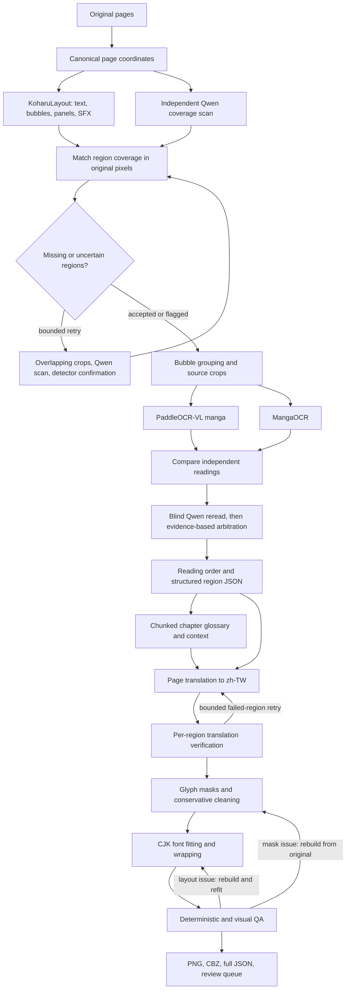

# Pipeline design and artifact contract



English uses regular PaddleOCR. Mixed/unknown language takes an explicitly
configured multilingual route. MangaLMM can provide an additional coverage scan.
CTD integration uses an external command adapter and is disabled by default.

## Evidence and uncertainty

No model-produced confidence is treated as calibrated probability. Detection
scores, independent OCR strings, arbitration decisions, and uncertainty reasons
are stored separately. OCR equality ignores whitespace only, preserving meaningful
punctuation and character differences. Negation/numbers/names are explicitly
checked in the VLM prompts. Failed or malformed model outputs raise errors; an
empty response is never converted into a passing result.

The default only asks for Qwen's blind crop transcription on disagreements or a
single-reader route. `ocr.qwen_blind_read: always` enables it on every text crop.
The blind request contains no specialist transcription. Reconciliation then sees
the candidates and the original crop plus surrounding visual context.

Accepted automatic arbitration remains flagged by default. Set
`review.flag_arbitrated_ocr: false` only if you want visually resolved arbitration
to pass automatically. An unresolved source remains flagged through translation
and rendering. Source agreement does not resolve region coverage uncertainty.

## Geometry and grouping

All saved boxes/polygons/masks use canonical original-page pixels. VLM requests
and replies use normalized 0..1000 image coordinates. Crop results are mapped back
using their crop origin; transport resizing preserves aspect ratio.

Layout regions receive stable IDs within a detection artifact. Rerunning a
different detector can change IDs: review overrides must be checked after such a
change. Text boxes associated with the same bubble are grouped; original member
IDs/geometries remain in `member_regions`. Separate narration and SFX are retained.
Text-to-bubble/panel association is geometric, not ground-truth speaker attribution.
Koharu masks are instance segmentation; they still need inspection/refinement for
erasure. Displayed polygons may be rectangular envelopes while masks carry shape.

Example region fields:

```json
{
  "region_id": "p0001_r0001",
  "kind": "text",
  "bbox": [100, 100, 220, 300],
  "polygon": [[100,100],[220,100],[220,300],[100,300]],
  "bubble_id": "p0001_r0002",
  "panel_id": "p0001_r0003",
  "mask_path": "/absolute/path/to/glyph-mask.png",
  "crop_bbox": [92,92,228,308],
  "coordinate_transform": {"crop_origin":[92,92],"scale":[1,1]},
  "reading_order": 0,
  "original_text": "原文",
  "ocr_candidates": {},
  "uncertainty": [],
  "status": "auto_passed",
  "translation": {"text":"譯文","status":"auto_passed","issues":[]}
}
```

## Retry policy

`retries.*` counts retries after the initial pass. Coverage retry uses overlapping
original-resolution tiles; it does not claim to recover information by generative
upscaling. Suspected new regions can be checked by the detector on a crop. OCR
retries use new padded crops and return to reconciliation. Translation retries
request only failed IDs while retaining chapter context. Visual retries use
bounded dilation/font adjustments, then rerun cleaning/typesetting from the
original into a new attempt directory. Persistent problems go to the review queue.

The runtime does not invent a speaker or force a reading order to be certain.
Chapter context is built from saved OCR in page chunks, avoiding an entire
chapter's full-resolution images in one prompt. Glossary evidence records region
IDs; uncertain readings must remain tentative. There is no automatic claim that a
VLM verifier is statistically independent of the translator.

## Runtime boundaries

Model adapters import their heavy dependencies lazily. `plan`, `doctor`, demo,
and tests never invoke an actual model or submit Slurm work. `run` and `serve` are
the explicit inference entry points; uncached model loads may download weights.
The demo's replies are scripted and its artifacts are labelled `mode: demo`.

The default same-node setup reserves the GPU for Qwen and uses host CPU for the
other networks. Configure a separate staged GPU run only after budgeting memory.
MangaLMM requires an independently provisioned endpoint; simply enabling it is
not a mechanism to fit two VLM servers on one GPU, least of all a 12 GB one.
